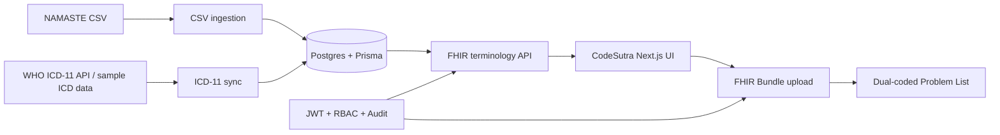

# CodeSutra

CodeSutra is a FHIR R4 terminology and clinical Problem List demo for dual coding NAMASTE traditional medicine terms with ICD-11 TM2 concepts. It includes a Node/Express API, PostgreSQL/Prisma persistence, JWT/RBAC/audit controls, Swagger docs, and a minimal Next.js demo UI.

## One Command Demo

```bash
cp .env.example .env
docker compose up --build
```

Services:

- API: `http://localhost:3000`
- Swagger: `http://localhost:3000/docs`
- Frontend: `http://localhost:3001`
- Postgres: `localhost:5432`

On API startup, Docker runs the schema sync and seeds the demo data from local sample files:

- `data/sample-namaste.csv`
- `data/sample-icd11.json`
- `data/sample-mappings.csv`

## Local Development

Backend:

```bash
npm install
docker compose up -d postgres
npx prisma db push
npm run seed:demo
npm run dev
```

Frontend:

```bash
cd frontend
cp .env.example .env.local
npm install
npm run dev
```

## Architecture



## Requirement Traceability

| Requirement | Endpoint / file |
|---|---|
| FHIR NAMASTE CodeSystem | `GET /fhir/CodeSystem/namaste`, `src/services/codeSystemBuilder.js` |
| ICD-11 TM2 / Biomedicine CodeSystems | `GET /fhir/CodeSystem/icd11-tm2`, `GET /fhir/CodeSystem/icd11-biomedicine`, `src/services/icd11CodeSystemBuilder.js` |
| WHO ICD-11 sync | `POST /admin/sync/icd11`, `src/services/whoIcdClient.js`, `src/services/icd11Sync.js` |
| Autocomplete | `GET /fhir/ValueSet/$expand`, `src/services/terminologyOps.js` |
| Lookup | `GET /fhir/CodeSystem/$lookup`, `src/services/terminologyOps.js` |
| Translate NAMASTE/TM2 | `POST /fhir/ConceptMap/$translate`, `src/services/terminologyOps.js` |
| ConceptMap | `GET /fhir/ConceptMap/namaste-to-tm2`, `src/services/conceptMapBuilder.js` |
| Bundle upload with dual coding | `POST /fhir/Bundle`, `src/services/problemList.js` |
| Problem List read/history | `GET /fhir/Patient/:abhaId/ProblemList`, `src/services/problemList.js` |
| OAuth2-shaped JWT prototype | `POST /auth/mock-token`, `src/lib/jwt.js` |
| RBAC | `src/middleware/auth.js`, `src/lib/rbac.js` |
| Audit trail | `AuditLog` model, `src/middleware/auditLogger.js`, `src/services/audit.js` |
| Versioning | `ProblemListEntry.version`, `ProblemListEntry.isCurrent` |
| Swagger JWT bearer auth | `src/config/swagger.js`, protected route JSDoc |
| Demo UI | `frontend/app/page.js` |

## Useful Commands

```bash
npm test
node src/scripts/dumpFhirSamples.js
npm run seed:demo
```

## Known Demo Limits

- WHO live sync requires real WHO ICD API credentials.
- JWT is a hackathon prototype, not real ABHA OAuth2/JWKS validation.
- In-memory cache is demo-grade.
- Mapping CSV is intentionally small and should be clinically expanded before production use.
